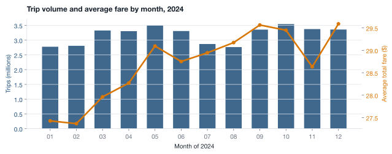
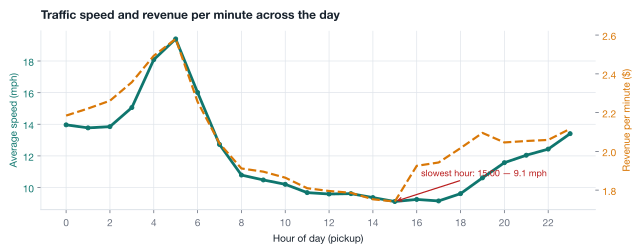

# NYC Taxi Demand & Operations

Yellow and green taxi trips in New York, January through December 2024. The question is where the network loses time and money, and what changed when congestion pricing started in January 2025.

The write-up is already built. Read it in the browser ([report.html](report.html)) or as a [PDF](NYC_Taxi_Analysis_Dirgha_Jivani.pdf).

| | |
| --- | --- |
| Trips kept | 39.7 million |
| Fare revenue | $1.12 billion |
| Average speed | 10.8 mph |
| Records kept | 95% of 41.8 million |

Speed fell through the year. Fare per mile rose with it.



The busiest hours are not the best paid ones. Midday traffic is slow, and revenue per minute peaks when the streets are clearer.



## How it is built

`analysis.py` loads the TLC files in DuckDB, drops bad trips, and writes every figure to `results.json`. The charts and the report only draw those numbers. Nothing in the prose is typed by hand.

```text
analysis.py  →  results.json  →  charts  →  report.html  →  PDF
```

A trip is kept when the pickup is in 2024, the dropoff is after the pickup, the ride lasts between a minute and three hours, the distance is under 100 miles, the fare looks real, both zones are known, and the implied speed is between 1 and 70 mph.

## Run it again

You need Python, DuckDB, matplotlib, and numpy.

```bash
python3 -m venv .venv
.venv/bin/pip install duckdb matplotlib numpy
```

The raw trip files are not in this repo. They are about 700MB. Download the 2024 yellow and green monthly files, plus yellow January 2025, from the [TLC trip records](https://www.nyc.gov/site/tlc/about/tlc-trip-record-data.page) and put them in `data/`. The zone lookup is already there.

```bash
./build.sh
```

That rebuilds the numbers, the charts, the HTML, and the PDF. The PDF step uses Google Chrome. `data/taxi_zone_lookup.csv` is the only data file checked in.

Prepared by Dirgha Jivani. Source data is public, from the NYC Taxi & Limousine Commission.
